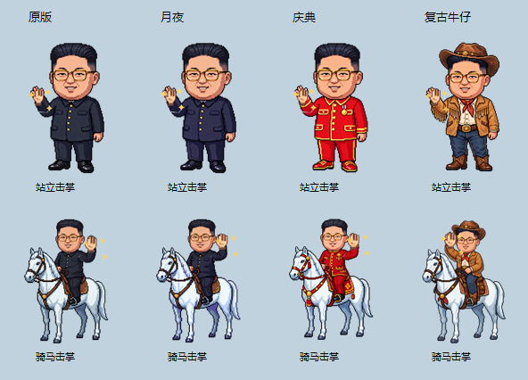

# 小太阳 · Windows 桌宠

音乐形态：开启“音乐识别”并播放音乐后，默认显示骑白马奔跑；双击可与当前歌曲封面和顺时针旋转的黑胶形态互换，按住仍可拖动。暂停或停止后恢复默认桌宠。普通播放器从 Windows 媒体信息获取封面；新版网易云没有媒体会话时，桌宠会用窗口标题匹配网易云本地播放列表，并加载其中的封面地址。未取得封面时显示白底太阳图。三分钟无操作的打盹规则保留。更新后请退出并重新启动桌宠。

黑胶过渡：进入黑胶形态时，唱片从封面后方向右滑出并开始顺时针旋转；暂停或停止时先停止旋转，再向左完整收入封面，最后恢复默认桌宠。收回过程中继续播放会立即重新滑出。

多播放器：桌宠分别检测网易云、酷狗和浏览器等应用的实时音量。先开始播放的来源保持封面，后来加入的声音不会抢占；当前来源连续静音 1.5 秒后，才切换到仍在播放的下一个来源。音量大小变化不会导致反复切换。

没有媒体封面的应用（例如部分本地视频客户端）开始发声时，会显示白底太阳默认封面，不会沿用 Spotify、网易云或酷狗的上一张音乐封面。

网易云控制：当前声音来源为网易云时，桌宠使用网易云 3.x 的全局快捷键控制播放/暂停、上一首和下一首；其他播放器继续使用 Windows 媒体会话控制。

删除提醒：打开托盘的“提醒”二级菜单，点击以“删除提醒｜”开头的提醒条目即可删除。删除入口不再展开第三级菜单，避免遮挡左侧一级菜单。

一个住在桌面上的像素风小宠物，能陪你倒计时、记待办、看日程，到点主动提醒你。

## 安装版（当前推荐）

在 [Releases 下载 NSIS 安装包](https://github.com/ggbo13/xiaotaiyang-desktop-pet/releases/latest)，退出旧桌宠后安装，从桌面或开始菜单的“小太阳桌宠”启动。安装包暂未签名，可能出现安全提示，NSIS 不保证不误报。

首次安装可在向导中选择旧版 `data` 文件夹导入；不会改动旧文件，也不会覆盖已有安装版数据。数据保存在 `%LOCALAPPDATA%\XiaoTaiYangDesktopPet\data`，升级和卸载均保留。以后以版本化安装包发布更新；[安装、数据与发布说明](docs/releasing.md)包含构建和测试命令。这里只托管桌面应用，不提供网页演示。



## 功能

- **倒计时**：托盘“倒计时”提供 5/10/25/30/60 分钟预设及“自定义…”。自定义窗口默认 `00 : 00 : 00`，将鼠标指向时、分、秒数字框并滚动滚轮即可调整。零时长不会启动。**只能同时一个**，执行时头顶实时显示剩余时间，结束自动消失。
- **待办**：在托盘“我的待办”二级菜单点击“＋ 添加待办…”。每条待办再展开可“标记为完成/恢复”或“删除此待办”。删除采用二次菜单操作，避免误删。
- **提醒**：托盘“提醒”二级菜单提供“添加提醒…”及已添加提醒列表，支持指定日期时间、多久以后或每隔一段时间重复提醒。提醒独立于“我的待办”，到期显示气泡、托盘通知并可选中文语音。
- **状态动画**：待机站立、工作专注、提醒跳起、完成变太阳（人脸太阳）、长时间没动静**躺在一弯月亮上闭眼睡觉**（会冒 Zzz）。
- **音乐识别**：结合应用实时音量与 Windows 媒体信息识别播放状态；播放时白马奔跑，双击可切换黑胶形态，暂停或停止后回到站立待机。可从托盘控制播放/暂停、上一首、下一首。
- **常驻托盘**：开机自启（可开关）、语音开关、音乐识别开关、播放/暂停、上一首/下一首、待办、提醒、倒计时、打盹、退出。
- **交互**：桌宠不再提供命令输入框；双击或拖动都不会打开命令栏，所有新增待办与自定义倒计时均在托盘菜单完成。
- **全屏隐藏**：网页视频、播放器或其他应用真正进入全屏时自动隐藏桌宠，退出全屏后自动恢复且不会抢走焦点；普通最大化窗口不会触发隐藏。
- **桌宠养成**：将鼠标移到桌宠上右键，可以摸摸、击掌或打招呼；托盘不显示互动菜单，黑胶形态不提供互动。实际使用电脑、首次完成待办和完成不少于 10 分钟的倒计时会增加亲密度；心情会影响闲聊内容。
- **主题外观**：托盘“成长与外观…”可查看等级、心情、今日奖励；在可滚动的两列卡片中预览站立和骑马形态并切换皮肤。“原版”和新增的棕金色“复古牛仔”更新后直接可用；亲密度 60 解锁“月夜”，150 解锁“庆典”，原有解锁条件不变。所选外观重启后保持。

### 养成操作

互动直接在桌宠本体上完成，管理功能仍保留在托盘：

- 将鼠标移到桌宠上右键 → “摸摸 / 击掌 / 打招呼”：摸摸保持直立、换上飞扬裙摆原地转身；击掌会伸手与短暂出现的像素手掌碰掌，闪出星光并播放短掌声，约 1.4 秒后收手；打招呼仍连续挥手并保留中文语音，不额外播放提示音。四套皮肤均支持站立和骑马击掌，音乐播放中的互动结束后恢复奔跑。
- 击掌继承原喂食的奖励与冷却：心情 +15、亲密度 +3，奖励冷却 60 分钟；旧冷却记录自动延续。冷却期间仍可互动和增加心情，不会重复增加亲密度。
- “成长与外观…”：查看亲密度、心情、每日奖励和四套皮肤预览。点击可用皮肤下方的“使用此外观”即可切换，重启后保持；旧版个人数据会保留，复古牛仔会自动加入可用外观。
- 每日陪伴最多获得 8 点、待办最多 32 点、有效倒计时最多 18 点。恢复已完成待办再勾选不会重复奖励。
- 心情最低保持 20，不会扣除亲密度，也不会收回已经解锁的皮肤。

## 运行

### 旧版分享免安装 ZIP（历史方式，以下保留供旧用户参考）

把 `dist\小太阳桌宠-免安装版-重复提醒-构建时间.zip` 发给对方。对方完整解压后双击“启动桌宠.vbs”即可运行；“启动桌宠.bat”是备用入口。ZIP 中是可直接查看的脚本、图片和模块，不使用容易被安全软件误判的自解压 EXE，也不包含制作者电脑上的待办、提醒和配置。收到新版时，先从托盘退出旧桌宠，再解压新版；若要保留自己的数据，将原来的 `data/` 文件夹留在程序目录。

源码更新后，在项目目录运行 `powershell -NoProfile -ExecutionPolicy Bypass -File .\tools\build-share-zip.ps1` 可生成本轮分享包。文件名使用台北时区的构建时间，保留旧包；脚本检查全部主题、击掌图、音效及启动文件，并检查包内没有个人 `data/`。

图片使用最多六张、合计 8 MiB 的冻结位图缓存，不预加载全部皮肤。成长窗口按预览框和显示缩放生成缩略图；关闭后释放图片。互动结束会清理临时效果和音效，计时器复用。全屏或手动隐藏时停止视觉动画，提醒、倒计时、睡眠判断和音乐检测继续运行，恢复显示时按当前状态重建动画；不降低可见动画帧率，也不定时强制回收内存。

### 旧版单文件 EXE（本次不更新，不推荐用于公开分享）

把 `dist\小太阳桌宠.exe` 单独发给对方即可。首次运行会把程序文件释放到当前用户的 `%LOCALAPPDATA%\XiaoTaiYangDesktopPet\app` 后静默启动，待办、提醒和配置会在对方电脑上独立创建，不包含制作者电脑上的个人数据。程序使用 Windows 自带的 PowerShell 5.1，无需安装 PowerShell 7。

当前 EXE 没有商业代码签名证书，Windows 可能显示“未知发布者”或 SmartScreen 提示。本次复古牛仔更新只生成免安装 ZIP，旧 EXE 不包含这些新改动。

### 添加提醒

右键系统托盘的小太阳图标 → “提醒” → “添加提醒…”，填写事项后选择三种方式之一：

- “指定日期和时间”：选择日期并设置时、分、秒，例如明天 14:30:00 提醒开会。
- “多久以后”：设置小时、分钟、秒，例如 0 小时 30 分钟 0 秒后提醒喝水；相对时间从点击“添加提醒”时开始计算，最长 7 天。
- “每隔一段时间”：默认 1 小时，可分别调整小时、分钟、秒，例如填写“站起来活动一下”，设置 1 小时 0 分钟 0 秒。添加一小时后首次提醒，每次提醒后继续计时一小时，不要求刚好整点；间隔必须大于零且不超过 7 天。切换到“多久以后”不会覆盖各自已输入的时长。

重复提醒保存在“提醒”二级菜单，显示“每1小时”等间隔及下次提醒时间；不会进入待办，也不会增加亲密度。重启后继续生效，错过多轮时最多补一次，再从本次提醒或重启时重新计算下一轮，不会连续补发。要停止重复提醒，点击原菜单中对应的“删除提醒｜”条目；其他提醒不受影响。

点击“添加提醒”保存。空事项、过去的时间和零时长会在窗口中提示，修正后可直接再次提交。提醒与倒计时相互独立，可以添加多条；已添加提醒直接显示在“提醒”的二级菜单中，列出时间、事项和“待提醒 / 已提醒”状态，不再显示在“我的待办”中。点击以“删除提醒｜”开头的对应条目即可删除；删除不会影响普通待办或倒计时，重启后也不会恢复。

旧版本已添加的定时提醒会自动归入“提醒”菜单，原有时间和是否已提醒的状态保持不变，无须重新添加。

到点会显示桌宠气泡、托盘通知，并按“开启语音”开关决定是否播报。一次性提醒触发后显示“已提醒”，不再重复提醒；托盘通知是否显示还受 Windows 通知设置影响。桌宠退出或电脑关机时不能实时通知，下次启动会补提示错过的提醒；电脑休眠期间到期的提醒会在恢复运行后处理。

取消计时：右键右下角托盘中的小太阳图标 → “倒计时” → “取消当前倒计时”。剩余时间立即隐藏，该计时不会再触发提醒，重启后也不会恢复；普通待办不受影响。没有正在进行的倒计时时，会提示“当前没有正在进行的倒计时”。

**双击 `启动桌宠.vbs`**（推荐，完全无黑窗），或双击 `启动桌宠.bat`。两个入口都会优先用系统自带的 **Windows PowerShell 5.1**（零安装、默认 STA），仅在 5.1 缺失时使用 PowerShell 7。

也可直接：

```powershell
powershell -NoProfile -ExecutionPolicy Bypass -WindowStyle Hidden -STA -File .\xiaotaiyang.ps1
```

## 文件说明

- `小太阳.ps1` — 入口，调度、提醒、聊天与托盘逻辑。
- `xiaotaiyang.ps1` — 无中文文件名的同一入口（供 .bat/.vbs/开机自启调用，避免编码问题）。
- `启动桌宠.vbs` / `启动桌宠.bat` — 无窗口启动器。
- `modules/PetIntent.psm1` — 规则意图解析（输出 `{action, params}`）。
- `modules/PetStore.psm1` — 数据持久化 + 重复周期推进。
- `modules/PetTalk.psm1` — Windows 语音（zh-CN）。
- `modules/PetMusic.psm1` — 音乐识别与控制（System Media Transport Controls）。
- `modules/PetGrowth.psm1` — 亲密度、心情、互动冷却、皮肤解锁与成长窗口。
- `modules/PetWindow.psm1` — WPF 透明置顶窗口、状态与动画。
- `modules/PetTray.psm1` — 托盘图标与菜单。
- `modules/PetAutoStart.psm1` — 开机启动注册。
- `modules/PetConfig.psm1` — 配置读写。
- `assets/` — 原版人物、骑马、睡觉与太阳素材，以及月夜、庆典、复古牛仔三套主题和互动素材；倒计时完成的太阳仍使用原版图，音乐封面仍取当前播放来源。
- `data/` — `todos.json` 与 `config.json`（首次运行生成）。
- `tests/parser-tests.ps1` — 意图解析测试。

## 测试

```powershell
powershell -NoProfile -ExecutionPolicy Bypass -File .\tests\parser-tests.ps1
```

## 数据与隐私

待办、提醒、配置与养成数据保存在本机；源码便携模式使用 `data/`，安装版使用上述 LocalAppData 数据目录。不调用 AI API；音乐封面读取可能访问播放器提供的封面网址及网易云接口，首次构建也需要网络。

公开库尚未附加开源许可证，不额外授予代码或素材复用权。专辑参考图、设计草图与个人记录不包含在公开源码或新安装包中。

## 说明

小太阳的原版形象取自用户提供的像素图，新增主题保留人物脸型、眼镜和白马比例。语音使用系统自带的 Microsoft Huihui（zh-CN），若无安装则自动静音兜底。开机自启默认开启，可在托盘关闭。音乐播放状态结合各应用的实时音量判断；没有提供有效媒体封面的来源会使用白底太阳封面。
